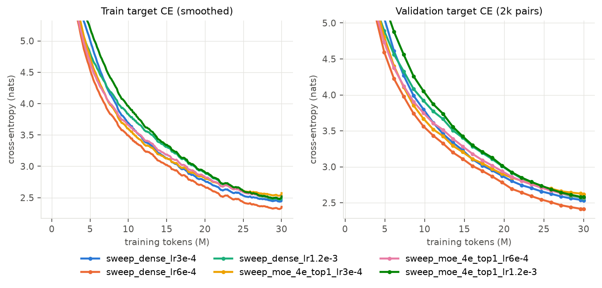
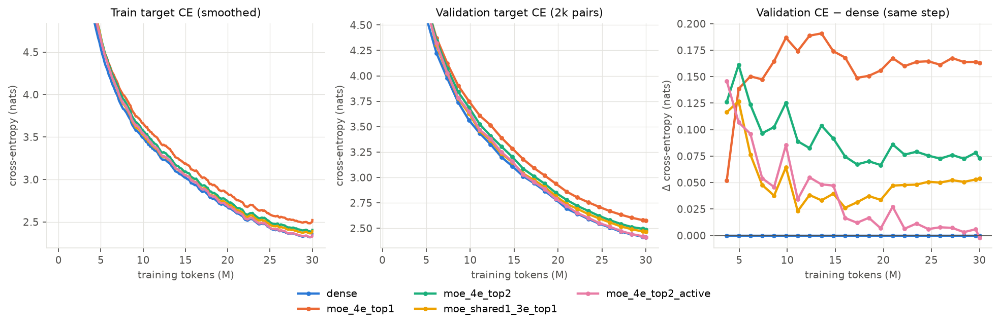
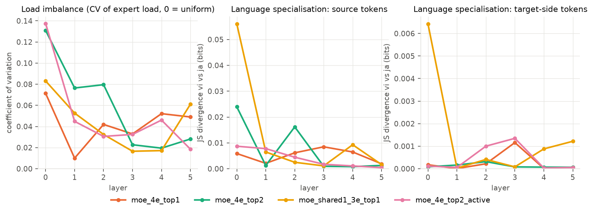
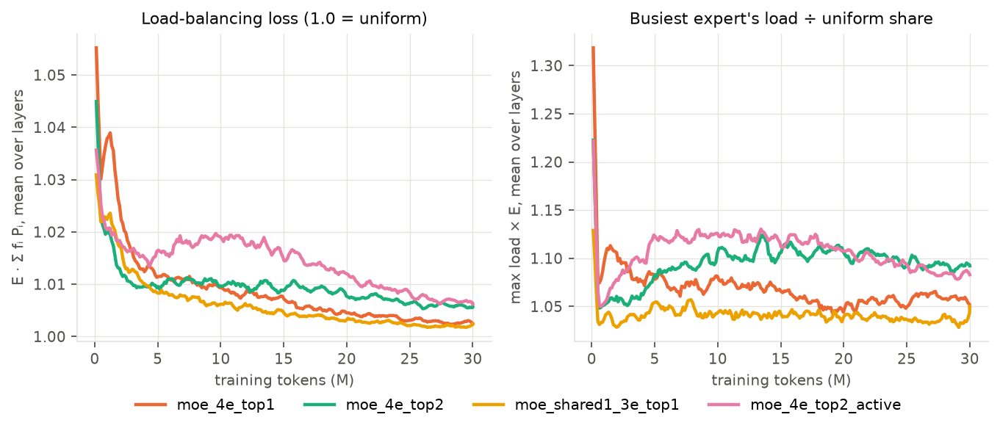
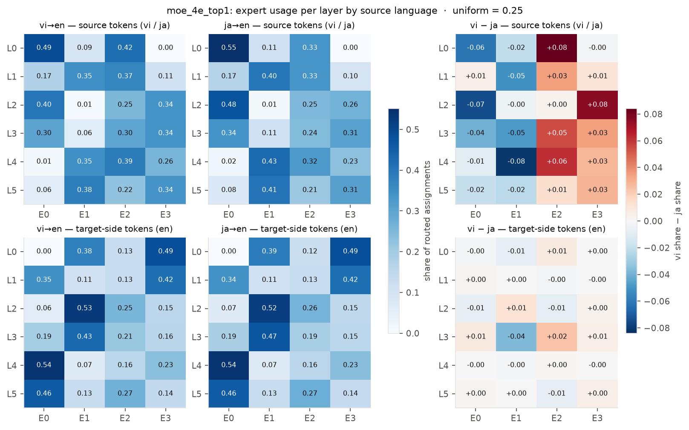
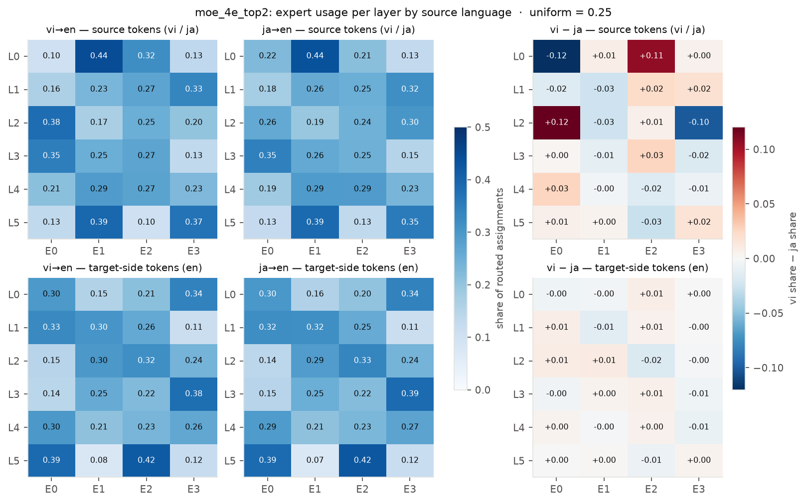
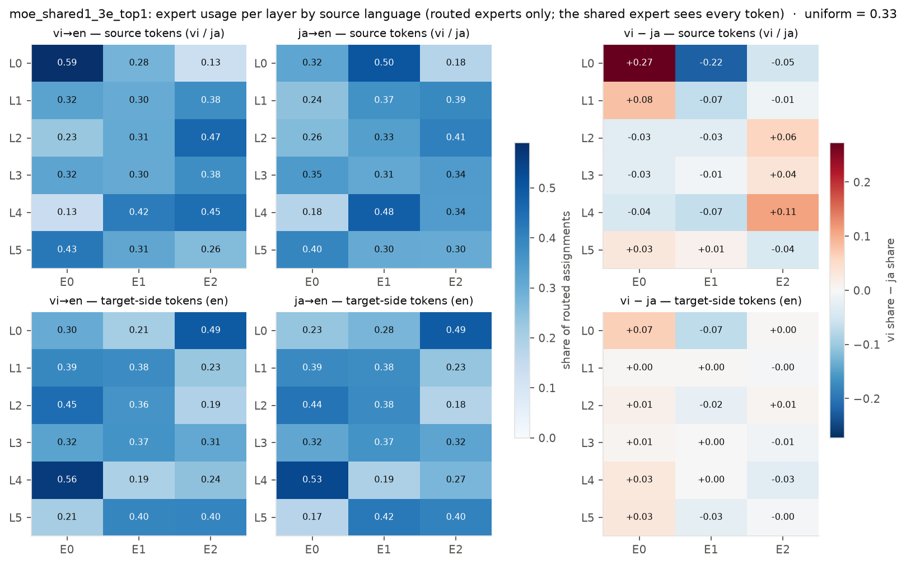
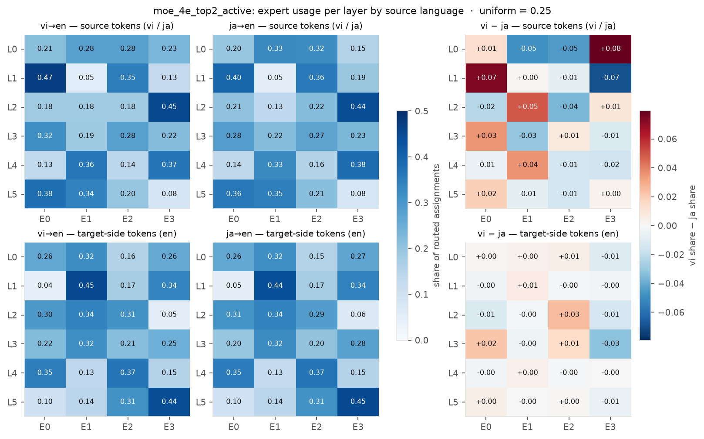

# Q1 — Mixture of Experts

Code lives in `src/part1/`. Every number and figure below comes from the CSVs in `src/part1/outputs/`, through
`python -m src.part1.analyze`, which writes the figures and tables to `src/part1/assets/`.

**Links.** WandB project: https://wandb.ai/likhitbhogadi-iiit-hyderabad/anlp-a2-q1 · HuggingFace checkpoints: see [§7](#7-checkpoints-and-logs).

## 1. Task and data

The model translates **Vietnamese → English** and **Japanese → English** using
`belumind/en-vi-ja-curated-500k-triplets`. That dataset has 446,252 train, 24,792 validation and 24,792 test
triplets. Each `(en, vi, ja)` triplet gives two training pairs, vi→en and ja→en.

**Tokenizer** (`tokenizer.py`). A single shared 32k BPE vocabulary covers all three languages. It is trained
on the train split only, with no romanisation:
- Text is NFKC-normalised and split on spaces only (Metaspace). Japanese is written without spaces, so it
  still forms multi-character merges such as `クエスト`, `された` and `ません。`.
- Byte fallback handles the rare characters outside the 6,000 most frequent, so there is no `<unk>`. Byte
  tokens make up 0.000% of tokens on a 20k-triplet sample of Japanese text.
- Average token rates are 1.36 tokens/word for en, 1.14 tokens/word for vi, and 0.41 tokens/character for ja.
- `tokenizer.json` (2 MB) is not in git because of the repository size limit. A copy is in every Q1
  HuggingFace model repo, and `python -m src.part1.tokenizer` retrains it from the dataset.

**Sequence format.** Each pair is one decoder-only sequence:
`<bos> <vi|ja> source… <2en> target… <eos>`. The loss covers only the target tokens and `<eos>`; source
positions are masked.

**Filtering.** Pairs longer than 160 tokens are dropped. For the length distribution, the 99th percentile is
148 tokens for vi→en and 134 for ja→en. A triplet is dropped if either of its pairs is too long. That removes
0.57% of train triplets and 0.54% of test triplets.

**Equal token budget.** Every model sees exactly the same **30,000,153 training tokens** (source + target +
special tokens) in the same order:
- The train triplets are shuffled once with a fixed seed.
- The shortest prefix of that order whose two pairs per triplet reach 30M tokens is kept. That is 388,936
  triplets (87% of the train split), giving 777,872 pairs, of which 13.83M are target tokens.
- That prefix is used for one epoch: 12,155 steps of 64 sequences.

Every final run ends with `tokens_seen = 30,000,153` and `target_tokens_seen = 13,829,140`, as the logs and
WandB summaries show.

**Evaluation sets.** Every usable test triplet is used, giving 24,657 triplets and 49,314 pairs. They are used
for both perplexity and BLEU. A fixed 2,000-pair validation subset is evaluated every 500 steps during
training.

## 2. Model

All variants share the same model (`model.py`), structured as the Appendix suggests
(`TransformerConfig` → `MLP` / `MoE` → `Block` → `Transformer`):
- a pre-norm decoder with RMSNorm and rotary position embeddings (RoPE);
- causal multi-head attention through `F.scaled_dot_product_attention`;
- d_model 512, 6 layers, 8 heads, and tied input/output embeddings;
- a feed-forward block that is the only part that changes between variants.

In every layer, the FFN is one of:

| # | variant | FFN per layer | top-k | total params | active params |
|---|---|---|---|---|---|
| 1 | `dense` | 2-layer GELU MLP, 512→2048→512 | – | 35.27M | 35.27M |
| 2 | `moe_4e_top1` | 4 experts × (512→512→512) | 1 | 35.28M | 25.84M |
| 3 | `moe_4e_top2` | 4 experts × (512→512→512) | 2 | 35.28M | 28.99M |
| 4 | `moe_shared1_3e_top1` | 1 shared expert, always on, plus 3 routed experts (each 512→512→512) | 1 | 35.27M | 28.98M |
| 5 | `moe_4e_top2_active` | 4 experts × (512→1024→512) | 2 | 47.86M | 35.28M |

**Matching parameters.**
- Variants 2–4 split the dense layer's 2,048 hidden units into four experts of 512, so total parameters match
  dense. The router adds only 512 × E weights per layer.
- Variant 5 doubles each expert to width 1,024. Two active experts × 1,024 = 2,048 hidden units per token, so
  its active parameters match dense.
- "Active" counts every parameter a token uses: embeddings, attention, the router, the shared expert, and its
  k routed experts.

**MoE layer** (`model.MoE`, written from scratch):
- **Routing.** A linear router produces logits; a softmax over experts gives probabilities, and each token
  keeps its top-k experts.
  - With k = 2, the two gate values are renormalised to sum to 1.
  - With k = 1, the gate is the raw router probability. Renormalising would always give 1, and the router
    would then get no gradient from the language-modelling loss.
- **Dispatch.** No token is ever dropped (no capacity factor). Each expert gathers exactly the tokens routed
  to it (`index_select`), runs its MLP, and scatters the gate-weighted outputs back (`index_add_`).
- **Shared expert.** It is added to every token's output without a gate.
- **Padding.** Padding tokens are never routed and never count towards the auxiliary losses.
- **Auxiliary losses.** Both are summed over layers and added to the cross-entropy loss:
  - the Switch-Transformer load-balancing loss, `E · Σᵢ fᵢ Pᵢ`, with weight 0.01. Here fᵢ is the share of
    routing assignments that go to expert i and Pᵢ is its mean router probability. It equals 1.0 when routing
    is perfectly uniform.
  - a router z-loss, `mean(logsumexp(logits)²)`, with weight 0.001.
- **Self-test.** `python -m src.part1.model` checks that:
  - the vectorised dispatch matches a naive loop over tokens, one at a time;
  - padding leaves the real tokens' outputs unchanged;
  - left-padded prefill plus KV-cache decoding reproduces the logits of a full forward pass.

## 3. Training

All five runs use identical settings apart from the FFN (`train.py`, `config.yaml`):
- **Optimiser:** AdamW with betas (0.9, 0.95) and weight decay 0.1 on matrices only.
- **Schedule:** 500 warmup steps, then cosine decay to 10% of the peak learning rate.
- **Other:** gradient clipping at 1.0, bf16 autocast, batch of 64 sequences, and the same initialisation seed
  for every run.

**Learning-rate sweep.** The sweep tried 3e-4, 6e-4 and 1.2e-3 on `dense` and `moe_4e_top1`, at the full
30M-token budget. `moe_4e_top1` was included as the variant most likely to prefer a different learning rate.
The WandB runs carry the tag `sweep`, and the curves are in `assets/lr_sweep_curves.png`.

| final val CE | 3e-4 | **6e-4** | 1.2e-3 |
|---|---|---|---|
| dense | 2.534 | **2.413** | 2.562 |
| moe_4e_top1 | 2.618 | **2.576** | 2.578 |

6e-4 is best for both, and no run showed loss spikes, so all five final runs use 6e-4. Re-running dense at
6e-4 gave exactly the same final validation CE (2.4127), and so did `moe_4e_top1` (2.5756), so the pipeline is deterministic.

**Throughput** on one L40S: about 57k tokens/s for dense and about 35k tokens/s for the MoE variants. A final
run takes 9–15 minutes. The MoE slowdown comes from the dispatch loop over experts (small per-expert matrix
multiplies plus a host sync for each expert), not from extra floating-point operations.

## 4. Evaluation protocol (`evaluate.py`)

- **Perplexity** is `exp(mean target-token cross-entropy)` with teacher forcing, over all 49,314 test pairs.
  It is reported separately for vi→en, ja→en and both.
- **BLEU** is corpus BLEU from `sacrebleu` with its default `13a` tokenisation, against the original
  (un-normalised) English references, over all 49,314 test pairs.
  - Translations use our own batched greedy decoding: prompts are left-padded, RoPE positions are corrected
    for the padding, a KV cache is used, and generation stops at `<eos>` or after 96 new tokens. HF
    `generate()` is not used.
- **Expert usage** is recorded during the teacher-forced test pass. For every layer, it counts how many
  routing assignments each expert receives. Counts are kept separately for:
  - each source language (vi or ja), and
  - each token side: *source* tokens (`<bos> <lang>` and the source sentence) vs *target-side* tokens (`<2en>`
    and the English, which the model is generating).

  Per-token-id counts are kept as well, to see what each expert specialises in.

## 5. Results

All numbers are on the full test set (49,314 pairs). The full tables are in `assets/tables.md`.

| variant | total | active | PPL vi→en | PPL ja→en | **PPL both** | BLEU vi→en | BLEU ja→en | **BLEU both** |
|---|---|---|---|---|---|---|---|---|
| dense | 35.27M | 35.27M | 8.26 | 13.36 | **10.51** | 34.01 | 24.11 | **29.09** |
| moe_4e_top1 | 35.28M | 25.84M | 9.55 | 15.98 | 12.35 | 31.62 | 21.87 | 26.77 |
| moe_4e_top2 | 35.28M | 28.99M | 8.75 | 14.48 | 11.26 | 32.93 | 22.73 | 27.79 |
| moe_shared1_3e_top1 | 35.27M | 28.98M | 8.64 | 14.07 | 11.02 | 32.99 | 23.07 | 28.05 |
| moe_4e_top2_active | 47.86M | 35.28M | **8.23** | 13.45 | 10.52 | **34.37** | **24.30** | **29.36** |

**At the same total parameters (variants 1–4), quality follows active parameters.** Every MoE with dense's
total parameter count is worse than dense, in the same order as its active FFN size:
- `dense` uses 12.6M active FFN params: PPL 10.51.
- `moe_4e_top2` and `moe_shared1_3e_top1` use 6.3M: PPL 11.26 and 11.02.
- `moe_4e_top1` uses 3.2M: PPL 12.35.

BLEU falls in the same order, from 29.1 to 26.8. Splitting a fixed parameter budget into experts doesn't help
here, because each token then uses only part of the FFN.

The third panel of the loss curves shows the gaps settling after about 15M tokens. At the end they are +0.16
nats for top-1, +0.075 for top-2 and +0.05 for shared+top-1. They are not closing, so this isn't just MoE
being slower to start.

**At the same active parameters, the larger MoE matches dense.** `moe_4e_top2_active` has twice dense's FFN
parameters but the same compute per token:
- It ties dense on perplexity (10.52 vs 10.51) and is slightly better on BLEU: +0.27 overall, +0.36 vi→en and
  +0.19 ja→en.
- Its validation gap to dense shrinks steadily, from +0.15 nats early on to about 0 at 30M tokens, and it
  dips slightly below dense on the last evaluation.

The extra expert capacity is therefore starting to pay off. With only 30M tokens, though, each expert sees
roughly half of the tokens, so it gets about half the training signal of the dense FFN. A longer budget would
probably widen MoE's lead. That matches the general finding that MoE gains grow with data. At this budget the
difference in BLEU is within noise.

**A shared expert beats plain top-2 at the same active size.** `moe_shared1_3e_top1` and `moe_4e_top2` both
activate 2 × 512 hidden units per token. The shared design has lower perplexity (11.02 vs 11.26) and higher
BLEU (28.05 vs 27.79) for both languages.
- One expert that sees every token learns the processing all tokens need, so the routed experts can
  specialise. Its routing also chooses among 3 experts instead of choosing 2 of 4, which is an easier problem.
- Its load is also the most even of all variants (busiest expert 1.05× an even share; see §6).

**Top-2 is better than top-1** (11.26 vs 12.35 PPL, 27.8 vs 26.8 BLEU). This partly reflects having twice the
active parameters. Top-2 also mixes two experts' outputs, which gives smoother gradients to the router and
experts than one hard choice per token.

**Japanese is the harder source language for every variant.**
- Perplexity is 13.4–16.0 for ja→en against 8.2–9.6 for vi→en, and BLEU is about 10 points lower.
- Vietnamese uses Latin script and SVO word order, and many of its words line up one-to-one with English.
- Japanese is SOV, has no spaces, and requires longer-range reordering.
- The ranking of the variants is the same for both languages.

**Compute cost.** On one L40S, dense trains at about 57k tokens/s and the MoE variants at about 35k tokens/s.
The equal-active MoE does as well as dense, but it was about 1.6× slower in wall-clock time with our simple
per-expert dispatch loop. Fused or grouped expert kernels would remove most of that overhead.

**Sample translations.** These are in `assets/tables.md`. They are the same 8 random short test sentences
translated by every model, and the outputs are near-identical on easy sentences. The main failure mode of all
models is greedy-decoding repetition on long or list-like inputs, for example
`… of the year of the year of the year …`.

## 6. Expert usage and specialisation

The routing statistics come from the teacher-forced pass over all 49,314 test pairs. Every routing assignment
is counted per layer and expert, split by source language (vi or ja) and by token side:
- **source**: `<bos> <lang>` and the vi or ja sentence;
- **target side**: `<2en>` and the English being generated.

**Load balance is good in every MoE.** No expert collapsed or went unused.

| variant | load CV (mean over layers) | busiest expert ÷ even share | normalised load entropy |
|---|---|---|---|
| moe_4e_top1 | 0.043 | 1.05 (worst layer 1.09) | 0.999 |
| moe_4e_top2 | 0.060 | 1.09 (1.22) | 0.998 |
| moe_shared1_3e_top1 | 0.044 | 1.05 (1.12) | 0.999 |
| moe_4e_top2_active | 0.052 | 1.08 (1.24) | 0.999 |

- The load-balancing loss stays between 1.00 and 1.02 throughout training (1.0 means perfectly even) and keeps
  falling.
- Layer 0 is the most uneven layer in every model. Its routing depends almost entirely on the token embedding,
  which is the least mixed representation.
- The shared-expert variant is the most balanced. It also needs the least from its router: with the shared
  expert always on, routing just adds one of 3 specialists.

### Heatmaps: experts per input language

`moe_4e_top1`, shown first:

**Experts specialise on source vs English far more than on vi vs ja.** The clearest example is `moe_4e_top1`.
- In layer 0, expert E0 takes 49–55% of the source tokens but 0% of the English target-side tokens. E3 takes
  49% of the English tokens but 0% of the source tokens.
- In layer 2, E1 handles 52–53% of the English tokens but only 1% of the source tokens.
- `moe_4e_top2` shows the same pattern more weakly, because with top-2 each token also uses a second expert.
  - In layer 5, E2 takes 42% of target tokens but only 10–13% of source tokens.
  - In layer 5, E1 takes 39% of source tokens but only 7–8% of target tokens.

For decoder-only translation, the most useful division of labour is between *reading* the input and *writing*
English.

**Specialisation by input language is weak, is limited to the source side, and is strongest in early layers.**
- The vi-minus-ja difference heatmaps are close to zero for the English target-side tokens: at most 0.07, and
  usually under 0.02. Once the model is generating English, routing barely depends on the source language.
- On the source side there is some language preference, mostly in layer 0:
  - `moe_shared1_3e_top1`, layer 0: expert E0 takes 59% of Vietnamese tokens vs 32% of Japanese, and E1 takes
    50% of Japanese vs 28% of Vietnamese.
  - `moe_4e_top2`, layer 0: E0 is ±0.12 toward Japanese and E2 toward Vietnamese.
  - `moe_4e_top2`, layer 2: E0 is ±0.12 toward Vietnamese and E3 toward Japanese.
- Measured as Jensen–Shannon divergence between the vi and ja expert distributions, the effect is small:
  - at most 0.056 bits (the shared-expert variant, layer 0), and under 0.01 bits from layer 3 onwards;
  - the averages over layers are 0.004–0.013 bits.

  No expert is a "Vietnamese expert" or a "Japanese expert" at the level of the whole language.

### What the experts do specialise in: token-level routing

Per token, routing is almost deterministic. For every frequent token (at least 200 test occurrences), we
measure its *purity*: the share of that token's occurrences that go to a given expert. Many frequent tokens
have purity 1.00, meaning they always go to the same expert. Below is a selection from `moe_4e_top1`; the full
lists for every variant are in `assets/tables.md`.

| layer | expert | most consistently routed tokens | interpretation |
|---|---|---|---|
| L0 | E0 | `そして`, `との`, `まで`, `「`, `▁私は`, `▁mà` | Japanese function words, particles and quotes |
| L0 | E1 | `▁company`, `▁products`, `▁offer`, `▁delivery`, `▁way` | English content words (target side) |
| L0 | E2 | `▁địa`, `▁phụ`, `▁quả`, `▁thay`, `▁tiền`, `▁xe` | Vietnamese syllables |
| L0 | E3 | `▁after`, `▁through`, `▁between`, `▁during`, `<2en>` | English prepositions, and the "now write English" token |
| L5 | E1 | `<bos>`, `<vi>`, `▁tham`, `▁tải`, `▁đăng` | sequence start and language tag, plus Vietnamese |
| L5 | E2 | `しました。`, `します。`, `することができます。`, `<2en>`, `▁Number:` | sentence-final Japanese verb endings, and boundary/format tokens |

- **Layer 0 groups tokens by script and type.** These are lexical clusters, and they don't add up to a
  language split. For example, E2 gets every occurrence of common Vietnamese syllables, but it also handles
  33% of Japanese source tokens.
- **Some experts group the same kind of word across languages.** In `moe_4e_top2`, layer 0, E0 takes `多くの`
  (many), `新しい` (new), `▁business`, `▁system`, `▁control` and `▁chuyên` (specialised): quantity and
  business vocabulary in all three languages. That is a cross-lingual semantic cluster.
- **Late layers group tokens by structural role.** The sequence-start and language-tag tokens
  (`<bos> <vi> <ja>`) consistently go to one expert in every variant's last layer. Sentence-ending and
  formatting tokens (`します。`, `<2en>`, `Number:`) go to another.

### Summary of the division of labour

- **Load:** routing spreads tokens almost evenly, with the busiest expert within 1.24× of an even share. The
  load-balancing loss prevents collapse at no visible cost.
- **Specialisation:** each expert handles a recognisable kind of token:
  - source text vs English output, which is the strongest effect;
  - script and part of speech in the first layer;
  - structural or boundary tokens in the last layer.
- **Language:** whole-language specialisation (vi vs ja) is weak and confined to the source side of early
  layers. At this scale, experts divide up token types and roles, not languages.

## 7. Checkpoints and logs

**WandB:** https://wandb.ai/likhitbhogadi-iiit-hyderabad/anlp-a2-q1. The final runs carry the tag `final`
and the LR sweep carries the tag `sweep`. Two runs that were stopped early carry the tag `aborted`; each was
replaced by a complete run with the same name.

| variant | HuggingFace checkpoint | WandB run |
|---|---|---|
| dense | https://huggingface.co/likhitbhogadi/anlp-a2-q1-dense | https://wandb.ai/likhitbhogadi-iiit-hyderabad/anlp-a2-q1/runs/78v384k7 |
| moe_4e_top1 | https://huggingface.co/likhitbhogadi/anlp-a2-q1-moe_4e_top1 | https://wandb.ai/likhitbhogadi-iiit-hyderabad/anlp-a2-q1/runs/6uhz699a |
| moe_4e_top2 | https://huggingface.co/likhitbhogadi/anlp-a2-q1-moe_4e_top2 | https://wandb.ai/likhitbhogadi-iiit-hyderabad/anlp-a2-q1/runs/hkjl0zzt |
| moe_shared1_3e_top1 | https://huggingface.co/likhitbhogadi/anlp-a2-q1-moe_shared1_3e_top1 | https://wandb.ai/likhitbhogadi-iiit-hyderabad/anlp-a2-q1/runs/vul66jar |
| moe_4e_top2_active | https://huggingface.co/likhitbhogadi/anlp-a2-q1-moe_4e_top2_active | https://wandb.ai/likhitbhogadi-iiit-hyderabad/anlp-a2-q1/runs/3r3fdsen |

Each HF repo contains:
- `model.safetensors` and `config.json`;
- the shared `tokenizer.json`;
- `test_translations.csv`, every greedy test translation with its reference and sentence BLEU;
- a model card with the test metrics.

**Reproduce.**
1. `python -m src.part1.tokenizer`
2. `python -m src.part1.data --prepare`
3. `bash src/part1/final.sh cuda:0`, which trains all five variants, evaluates them, and builds the figures
   and tables.

