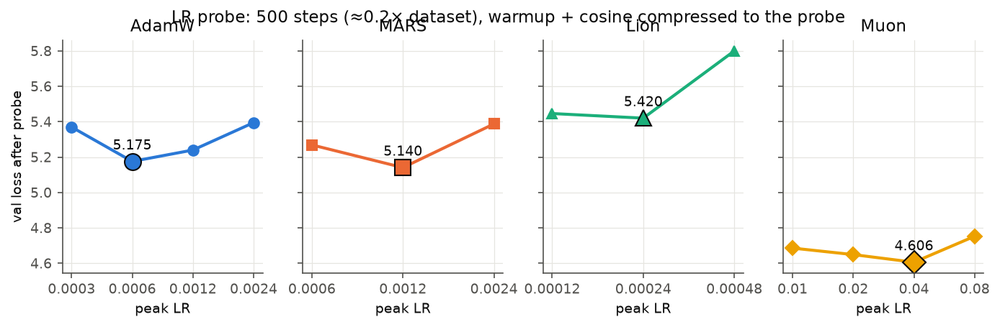
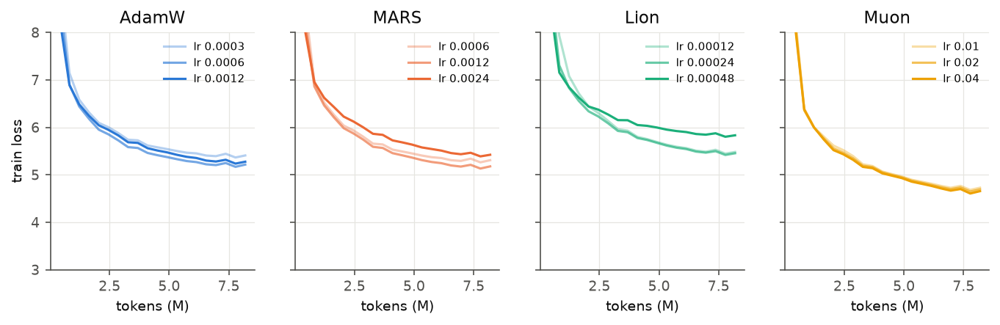
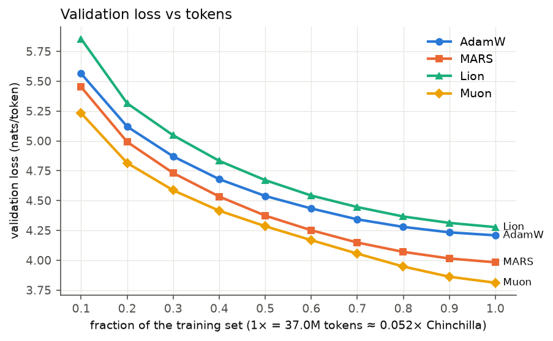
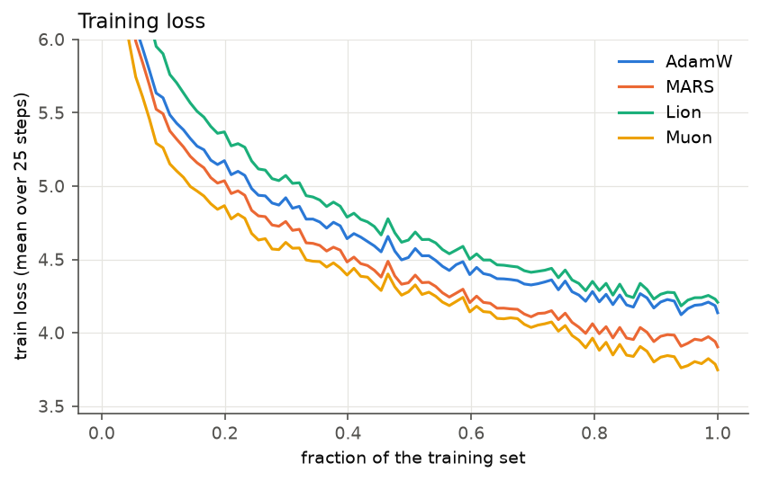
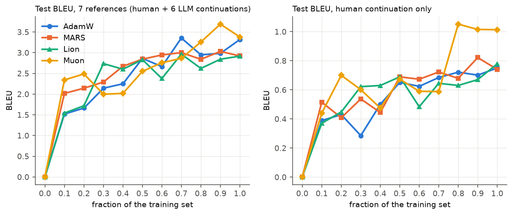
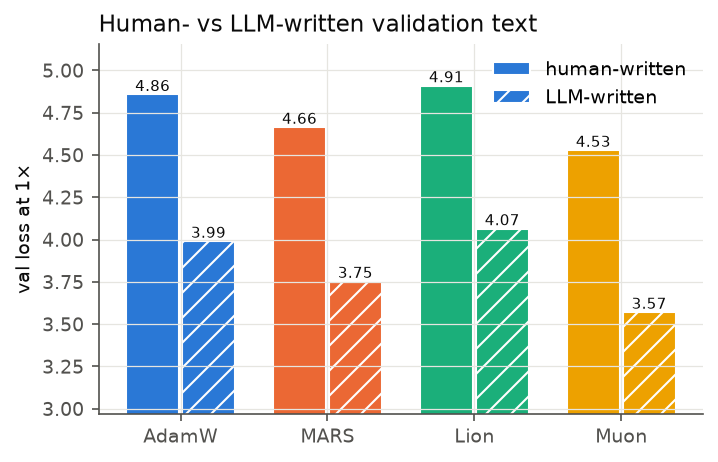

# Q2 — Optimizers

We pretrain the Q1 dense transformer (configuration 1) from scratch on `browndw/human-ai-parallel-corpus`
for next-token prediction. We use four optimizers, written from scratch, one from each of the first four
categories of Table 1 in Wen et al. (2025), *Fantastic Pretraining Optimizers and Where to Find Them*:

| Category (Table 1) | Chosen optimizer |
|---|---|
| AdamW | **AdamW** |
| Variance-reduced AdamW variants | **MARS** (MARS-AdamW, approximate) |
| Memory-efficient optimizers | **Lion** |
| Matrix-based optimizers | **Muon** |

The only `torch.optim` class used is `torch.optim.Optimizer`, as a base class. `torch.optim.AdamW` appears only
inside the self-test, as a numerical reference. The bonuses (Sophia, extended sweeps) were not attempted.

**Links**
- WandB project: `TODO: https://wandb.ai/<entity>/anlp-a2-q2`. Final runs are tagged `final`, LR probes `lr-probe`.
- HuggingFace checkpoints: `TODO: https://huggingface.co/<hf_user>/anlp-a2-q2-{adamw,mars,lion,muon}`

---

## 1. Setup

### 1.1 Data
HAP-E (Reinhart et al., 2024) has 66,320 rows: 8,290 source documents across 6 genres (academic, blog, fiction,
news, spoken, TV/movie scripts), each in 8 variants (`doc_id = <genre>_<num>@<variant>`):

- `chunk_1`: the human-written first ~500 words (the prompt the LLMs were given);
- `chunk_2`: the human-written continuation;
- 6 LLM continuations of `chunk_1`: GPT-4o, GPT-4o-mini, Llama-3-8B/70B, base and instruct.

| | train | val | test |
|---|---|---|---|
| source docs (× 8 variants) | 7,462 | 414 | 414 |
| tokens | 37.02M | 2.05M | 2.05M |
| human-written share of tokens | 24.9% | 25.1% | 25.1% |

- **Doc-level split.** All 8 variants of a document go to the same split, stratified by genre (seed 0). This
  matters: the 7 continuations of a test prompt share a lot of content with each other and with the prompt, so a
  row-level split would leak test text into training.
- **Tokenizer.** A new English byte-level BPE with vocab 32,000, trained on train-split text only (1.25 tokens
  per word). The vocabulary size matches Q1, so the model has exactly the same size as the Q1 dense baseline.
- **Training stream.** Every training row, followed by `<eos>`, in a fixed shuffled order, packed into 512-token
  windows. With batch size 32 (16,384 tokens/step), **1× the dataset is 2,259 steps = 37.01M tokens**.

### 1.2 Model
This is the Q1 dense configuration 1, reused unchanged (`src/part1/model.py`): a decoder-only transformer with
d_model 512, 6 layers, 8 heads, a 2-layer GELU MLP with d_ff 2048, RMSNorm (pre-norm), RoPE, and tied embeddings.
It has **35.27M parameters** (18.88M non-embedding).

**Chinchilla ratio.** 20 × 35.27M = 705M tokens, so **1× the dataset = 0.0525× Chinchilla**. This is the "not
exactly a clean fraction" the assignment mentions: we train far below the compute-optimal token count, whereas
the paper uses 1–8× Chinchilla.

### 1.3 Shared training protocol (identical for every optimizer)
- Same init (seed 0), and the same batches in the same order.
- LR schedule: linear warmup over 5% of steps, then cosine decay to 10% of the peak. Each optimizer's
  param groups scale their own peak LR by this multiplier.
- Gradient clipping at global norm 1.0; bf16 autocast with fp32 weights and optimizer states.
- Weight decay is decoupled and applies to ≥2-D tensors only (the Q1 grouping).
- Evaluation at step 0 and then at every **0.1× of the dataset** (every ~226 steps): 11 evaluation points per run.

### 1.4 Evaluation
**Validation loss.** Mean next-token cross-entropy over the whole packed validation stream (2.05M tokens). A
per-token source tag also lets us split it into human-written vs LLM-written text and by genre.

**Test BLEU (continuation BLEU, multi-reference).** This metric uses the parallel structure of the corpus:
- For each of the 414 test documents, the prompt is the **last 128 tokens of `chunk_1`**. The model writes a
  greedy continuation of exactly 64 tokens (our own KV-cached decoder; `<eos>` is banned because the prompt is
  cut mid-document).
- The **7 continuations of the same prompt** (human `chunk_2` + the 6 LLM continuations) are all valid
  references, each cut to its first 64 tokens.
- We report corpus sacreBLEU (13a) against all 7 references (the main metric) and against the human continuation
  alone.

Open-ended continuation is far less constrained than translation, so absolute BLEU values are small. Multiple
references reduce, but do not remove, the penalty for a plausible continuation that differs from one particular
reference.

---

## 2. Optimizers

All code is in `src/part2/optimizers.py`. Notation: g = gradient, η = LR (schedule-scaled), λ = weight decay.
Weight decay is always decoupled: w ← w − ηλw.

### 2.1 AdamW (baseline)
m ← β₁m + (1−β₁)g,  v ← β₂v + (1−β₂)g²,  w ← w − η · (m/(1−β₁ᵗ)) / (√(v/(1−β₂ᵗ)) + ε) − ηλw.

Hyperparameters: β = (0.9, 0.95), ε = 1e-8, λ = 0.1. Verified step-for-step against `torch.optim.AdamW`
(test only).

### 2.2 MARS (variance-reduced AdamW)
MARS adds a STORM-style variance-reduction term to the gradient, scaled by γ, then takes an AdamW step on the result:

c ← g_t + γ · β₁/(1−β₁) · (g_t − g_{t−1}),  c ← c / max(1, ‖c‖₂),  then AdamW on c.

- **Approximate variant.** Exact MARS needs ∇f(w_{t−1}) on the *current* batch, which costs a second backward
  pass. We use the approximate version (MARS-approx), which reuses the previous batch's gradient; this is the
  variant used in practice. As in the reference implementation, the correction applies only to matrices;
  1-D gains take a plain AdamW step.
- **State:** m, v and g_{t−1} for matrices, so 3 copies of the parameters.
- **Hyperparameters:** γ = 0.025, β = (0.95, 0.99), ε = 1e-8, λ = 0.1.

### 2.3 Lion (memory-efficient)
u = sign(β₁m + (1−β₁)g),  w ← w − η·u − ηλw,  m ← β₂m + (1−β₂)g.

- **Memory:** a single momentum buffer, so half of AdamW's optimizer state.
- **Update size:** every coordinate moves by exactly ±η, so the update has a much larger norm than Adam's. Lion
  therefore needs an LR several times smaller than AdamW's (the Lion paper suggests 3–10×) and a correspondingly
  larger λ, so that the effective decay ηλ is comparable.
- **Hyperparameters:** β = (0.9, 0.99), λ = 1.0.

### 2.4 Muon (matrix-based)
For each 2-D hidden weight W (attention qkv/proj, MLP fc1/fc2):

m ← μm + (1−μ)g,  d = (1−μ)g + μm (Nesterov),  O = NS₅(d) · √max(1, rows/cols),  W ← W − ηO − ηλW.

- **NS₅** is the quintic Newton–Schulz iteration X ← aX + (bXXᵀ + c(XXᵀ)²)X with (a, b, c) = (3.4445, −4.7750,
  2.0315). It runs for 5 steps in bf16 on d/‖d‖_F and maps d ≈ USVᵀ to roughly UVᵀ: all singular values land
  in about [0.7, 1.15], as the self-test confirms.
- **Effect:** the update is steepest descent under the spectral norm. Every direction in the weight matrix's
  input/output space gets the same step size, instead of being dominated by the few largest singular directions
  of the gradient.
- **Fused qkv.** The fused 1536×512 qkv projection is orthogonalised as **three separate 512×512 blocks** (Q, K,
  V), since they are three different linear maps that happen to be stored together.
- **Embeddings and norms.** The tied embedding/LM-head and the RMSNorm gains are not hidden matrices. They take an
  AdamW step inside the same optimizer (adam_lr 1.2e-3, β = (0.9, 0.95), λ = 0.1 on the embedding only).
- **Hyperparameters:** μ = 0.95, Nesterov, 5 NS steps, λ = 0.1.

### 2.5 Correctness checks (`uv run python -m src.part2.optimizers`)
- AdamW matches `torch.optim.AdamW`; Lion and MARS match direct per-step implementations of the formulas above
  (10 steps, atol ≤ 1e-5).
- Newton–Schulz output singular values are in [0.67, 1.15] for wide, tall and batched inputs.
- Every optimizer, built through the same `build_optimizer` used in training (including Muon's param grouping and
  qkv split), trains a toy transformer. A check also confirms that every parameter belongs to exactly one group.

---

## 3. Hyperparameter search (low-compute LR probe)

Time was limited, so we followed the assignment's low-compute tip:
- **Probes.** Every LR candidate ran for only **500 steps (≈0.22× the dataset, 8.2M tokens)**, with the full
  warmup + cosine schedule compressed into those 500 steps, and was scored by val loss at the end.
- **Grids.** The grids were centred on Q1's best AdamW LR (6e-4). Lion's grid sits 2.5–10× lower and Muon's is
  on its usual scale.
- **Edge extension.** When the best value was at the edge of the grid (AdamW, Muon), one more point beyond the edge
  was added.
- **What was not tuned.** All other hyperparameters were fixed at common literature defaults (§2).



| Optimizer | Peak LRs probed | Val loss after 500 steps | **Chosen** |
|---|---|---|---|
| AdamW | 3e-4 / 6e-4 / 1.2e-3 / 2.4e-3 | 5.370 / **5.175** / 5.240 / 5.394 | **6e-4** |
| MARS | 6e-4 / 1.2e-3 / 2.4e-3 | 5.269 / **5.140** / 5.387 | **1.2e-3** |
| Lion | 1.2e-4 / 2.4e-4 / 4.8e-4 | 5.446 / **5.420** / 5.800 | **2.4e-4** |
| Muon | 1e-2 / 2e-2 / 4e-2 / 8e-2 | 4.686 / 4.649 / **4.606** / 4.752 | **4e-2** |



**Observations**
- **All optima are interior.** Every chosen LR has a worse neighbour on both sides.
- **AdamW agrees with Q1.** AdamW's optimum (6e-4) is the same as in the Q1 sweep, on a different dataset and task.
- **MARS tolerates a 2× larger LR than AdamW.** Its best LR is 1.2e-3. Its gradient clipping (‖c‖ ≤ 1) and
  larger β₁ both damp the update, which plausibly explains why it can take the larger step.
- **Lion is the most LR-sensitive.** Going from 2.4e-4 to 4.8e-4 costs **+0.38 nats**, whereas halving the LR costs
  only +0.03. Because every coordinate moves by exactly ±η, too large an η cannot be absorbed by adaptive scaling.
- **Muon is by far the least sensitive.** An 8× range of LR (1e-2 to 8e-2) changes the loss by only 0.15 nats, and
  its curves in the probe-curves figure almost overlap. The orthogonalised update has a fixed spectral scale, so the
  LR controls the step size directly and the gradient's scale does not matter.
- **The ranking already holds at 0.22×.** The probe ranking (Muon < MARS < AdamW < Lion) is exactly the final
  1× ranking (§4).

Caveat: the probes use a compressed (0.22×) schedule. The best LR for a 4.5× longer run is usually equal or slightly
lower, so the chosen LRs may be a little too high for the 1× runs. That would bias every optimizer in the same
direction.

---

## 4. Results at every 0.1× of the dataset

### 4.1 Validation loss vs tokens



| fraction of dataset | tokens | AdamW | MARS | Lion | Muon |
|---|---|---|---|---|---|
| 0.0 | 0 | 10.456 | 10.456 | 10.456 | 10.456 |
| 0.1 | 3.7M | 5.564 | 5.451 | 5.855 | **5.232** |
| 0.2 | 7.4M | 5.119 | 4.991 | 5.314 | **4.815** |
| 0.3 | 11.1M | 4.869 | 4.730 | 5.046 | **4.585** |
| 0.4 | 14.8M | 4.679 | 4.533 | 4.832 | **4.415** |
| 0.5 | 18.5M | 4.538 | 4.373 | 4.671 | **4.285** |
| 0.6 | 22.2M | 4.434 | 4.251 | 4.542 | **4.168** |
| 0.7 | 25.9M | 4.343 | 4.148 | 4.446 | **4.056** |
| 0.8 | 29.6M | 4.279 | 4.070 | 4.366 | **3.947** |
| 0.9 | 33.3M | 4.233 | 4.015 | 4.313 | **3.862** |
| 1.0 | 37.0M | 4.209 | 3.982 | 4.277 | **3.811** |



### 4.2 Test BLEU vs tokens



| fraction | AdamW | MARS | Lion | Muon |
|---|---|---|---|---|
| 0.0 | 0.00 | 0.00 | 0.00 | 0.00 |
| 0.1 | 1.52 | 2.02 | 1.54 | 2.34 |
| 0.2 | 1.66 | 2.14 | 1.72 | 2.49 |
| 0.3 | 2.14 | 2.29 | 2.74 | 2.00 |
| 0.4 | 2.25 | 2.67 | 2.60 | 2.02 |
| 0.5 | 2.86 | 2.84 | 2.83 | 2.55 |
| 0.6 | 2.67 | 2.95 | 2.38 | 2.76 |
| 0.7 | 3.35 | 3.00 | 2.97 | 2.86 |
| 0.8 | 2.95 | 2.84 | 2.62 | 3.26 |
| 0.9 | 2.98 | 3.03 | 2.84 | 3.69 |
| 1.0 | 3.32 | 2.92 | 2.92 | 3.38 |

(BLEU with 7 references. The human-reference-only values are in the right panel of the figure.)

### 4.3 Final results (1× dataset = 37.01M tokens ≈ 0.0525× Chinchilla)

| Optimizer | Peak LR | Val loss | Test loss | Test PPL | BLEU (7 refs) | BLEU (human ref) | Tokens to reach AdamW's final loss | Token speedup vs AdamW | ms/step | Optimizer state |
|---|---|---|---|---|---|---|---|---|---|---|
| AdamW | 6e-4 | 4.209 | 4.202 | 66.9 | 3.32 | 0.75 | 37.0M (1.00×) | 1.00× | 99 | 269 MiB (2× params) |
| MARS | 1.2e-3 | 3.982 | 3.978 | 53.4 | 2.92 | 0.74 | 23.7M (0.64×) | **1.56×** | 104 | 404 MiB (3×) |
| Lion | 2.4e-4 | 4.277 | 4.273 | 71.7 | 2.92 | 0.78 | never (≤ 1×) | < 1× | 100 | **134 MiB (1×)** |
| Muon | 4e-2 | **3.811** | **3.803** | **44.8** | **3.38** | **1.01** | **20.9M (0.57×)** | **1.77×** | 108 | 197 MiB (1.5×) |

- **Speedup** = 37.0M / (tokens the optimizer needs to reach AdamW's final val loss), linearly interpolated
  between the 0.1× eval points.
- **ms/step** is training wall time per step on one L40S (fwd + bwd + optimizer step, synchronised, evals
  excluded).
- **Optimizer state** is the total size of the optimizer's state tensors.

### 4.4 Validation loss by source and genre (1×)



| Optimizer | human | LLM | acad | blog | fic | news | spok | tvm |
|---|---|---|---|---|---|---|---|---|
| AdamW | 4.858 | 3.991 | 4.429 | 4.242 | 4.277 | 4.609 | 3.790 | 4.056 |
| MARS | 4.665 | 3.754 | 4.089 | 4.036 | 4.083 | 4.341 | 3.617 | 3.848 |
| Lion | 4.910 | 4.065 | 4.430 | 4.336 | 4.351 | 4.652 | 3.895 | 4.128 |
| Muon | **4.529** | **3.571** | **3.876** | **3.865** | **3.937** | **4.164** | **3.453** | **3.687** |

---

## 5. Analysis

### 5.1 Training dynamics
**Ranking.** The ranking **Muon < MARS < AdamW < Lion** holds at *every* eval point from 0.1× to 1×, in the probes
and in the final runs, on validation and test, and in every genre and source subset. With a single seed per
optimizer, this consistency is the strongest evidence we have that the differences are real. Train and validation
losses agree closely; there is no overfitting, as expected for a single pass over the data.

**Muon has the fastest start and stays ahead.**
- At 0.1× it is already 0.33 nats below AdamW, and at 1× the gap is 0.40.
- It reaches AdamW's final loss with **57% of the tokens (1.77× token speedup)**.
- Muon is also ahead of AdamW at every fixed LR in the probe (4.61–4.75 for all four LRs vs AdamW's best 5.18). So
  the advantage is not an artefact of tuning.
- Plausible reason: early in training, gradients of the weight matrices are nearly low-rank, dominated by a few
  directions. Adam's per-coordinate scaling does not change that. Orthogonalisation spreads each step equally over
  all singular directions, so many more directions learn at once.

**MARS is a solid second, at 1.56× token speedup.**
- Its gap to AdamW *grows* over training: 0.11 nats at 0.1×, 0.23 at 1×.
- This fits variance reduction mattering more as the LR decays and gradient noise dominates the update.
- Part of the gain may also come from MARS tolerating a 2× larger peak LR (§3).

**Lion is slightly worse than AdamW, but closes the gap.**
- It is 0.29 nats behind at 0.1× but only 0.07 behind at 1×. It does not reach AdamW's final loss within 1×.
- The slow start fits its fixed ±η step size: the LR had to be chosen small enough to be stable at the peak, which
  makes it conservative early on.
- Its advantage is memory, not speed: **half of AdamW's state** (134 vs 269 MiB).

### 5.2 Comparison with Wen et al. (2025)
**Qualitative agreement.**
- Matrix-based optimizers (Muon) give the largest gains at small scale.
- Variance-reduced AdamW variants give smaller but real gains.
- Lion does not beat a tuned AdamW.

**Our speedups are larger than the paper's.** The paper's headline is that speedups over a *well-tuned* AdamW are
well below the often-claimed 2×: at most ~1.4× for the smallest models, shrinking with scale. Our Muon speedup is 1.77×.
We see four reasons, all of which inflate speedups:
1. **AdamW is only LR-tuned.** We tuned AdamW's LR only. The paper's central point is that AdamW's other
   hyperparameters (β₂, weight decay, warmup, …) must be tuned too, and that an under-tuned baseline exaggerates
   speedups.
2. **Very low data regime.** We run at 0.05× Chinchilla, against the paper's 1–8×. Its Figure 2 shows the advantage
   of the matrix methods shrinking as the data-to-model ratio grows. At our ratio, the early-training advantage
   in §5.1 dominates.
3. **Points along one run, not separate runs.** Our 0.1×-interval points come from a single cosine run each. The
   paper's points are separate runs, each tuned and fully annealed for its budget. Mid-run, an optimizer whose
   cosine schedule has not yet decayed is penalised; this affects all optimizers in a similar way, but not
   identically.
4. **One seed, coarse grid.** One seed and an LR grid with steps of 2×. Differences of ≈0.03 nats, such as AdamW vs
   MARS in the probe, are within plausible noise. The 0.2–0.4 nat gaps of the final runs are not.

### 5.3 BLEU
- **The trend tracks loss.** BLEU rises from 0 to about 3 (7 references) as training proceeds, for every optimizer.
- **Below 0.5× it is too noisy to compare optimizers.** Successive evals jump by ±0.5 BLEU (e.g. AdamW 3.35 → 2.95 between 0.7× and 0.8×),
  which is as large as the gaps between optimizers. Corpus BLEU on 414 short continuations of a nearly free-form
  task is a high-variance metric.
- **Late in training, the best model does best.** At 0.8–1.0×, Muon has the best multi-reference BLEU at 0.8× and
  0.9×, and the best human-reference BLEU from 0.8× on (1.01–1.05 vs ≤ 0.82 for the others). MARS's clear loss
  advantage over AdamW does *not* show in BLEU (2.92 vs 3.32 at 1×).
- **Multiple references matter.** Multi-reference BLEU is 3–4× the human-only BLEU, because 7 references cover much
  more of the plausible n-gram space. This is the reason for using the parallel corpus.
- **Greedy decoding caps BLEU.** In the saved samples (`outputs/samples_final_*.csv`), all four models produce
  fluent topic-appropriate openings ("For example, …", correct register and citation style) but then fall into
  repetition loops, e.g. *"the literature on the literature on the literature…"*. Lower loss delays these loops but
  does not prevent them at this scale. This limits how well BLEU can separate the optimizers; Q3's decoding
  strategies address this, but here greedy decoding is kept fixed so that only the optimizer changes.

So, at this scale and budget, validation loss is the reliable signal. BLEU confirms the overall trend and Muon's
lead late in training, but cannot resolve the smaller differences.

### 5.4 Human- vs LLM-written text
- **LLM-written text is about 0.9 nats/token easier** to predict than human-written text (e.g. Muon 3.57 vs 4.53),
  for every optimizer.
- This fits the premise of the HAP-E paper: LLM continuations are stylistically more homogeneous and predictable
  than human writing.
- Our model also sees 3× more LLM tokens than human tokens in training (75% vs 25%).
- Muon's improvement over AdamW is slightly larger on LLM text (−0.42) than on human text (−0.33).
- Spoken transcripts are the easiest genre and news the hardest. The genre ordering is the same for all
  optimizers.

### 5.5 Cost: time and memory
**Time per step.** Per-step overheads are small at this size: MARS +5% (one extra elementwise pass), Lion +1%,
Muon +9%. For Muon, that is 5 Newton–Schulz iterations on 24 matrices of at most 2048×512, in bf16. Adjusted for
time per step, the **wall-clock speedups** to reach AdamW's final loss are about **1.62× for Muon** and **1.48× for
MARS**.

**Optimizer memory, relative to the 35.3M parameters:**
- **Lion:** 1× (momentum only).
- **Muon:** 1.5×. Momentum for the 18.9M hidden-matrix weights, plus two Adam moments for the 16.4M embedding.
  In larger models the embedding share shrinks, so Muon approaches 1×.
- **AdamW:** 2×.
- **MARS:** 3×, because it also stores the previous gradient.

Muon is therefore both the fastest-converging optimizer and the second-most memory-efficient here.

### 5.6 Limitations
- **One seed per configuration.**
- **Only the LR was tuned**, on a 0.22× compressed schedule. Other hyperparameters used literature defaults
  (Muon's inner AdamW LR was fixed at 1.2e-3 rather than tuned).
- **Intermediate points come from one cosine run** per optimizer, unlike the paper's independent per-budget runs.
- **Low-data regime.** A single model size at 0.05× Chinchilla, far below the paper's regime, so the results should
  not be extrapolated to larger scales or longer training.

---

## 6. Reproducing
```bash
uv run python -m src.part2.tokenizer                 # English BPE (train-split docs only)
uv run python -m src.part2.data --prepare            # doc-level split, token streams, BLEU items
uv run python -m src.part2.optimizers                # self-test (CPU)
bash src/part2/probe.sh cuda:0                       # LR probes (500 steps each)
bash src/part2/final.sh cuda:0                       # 4 full 1x runs at the LRs in config.yaml
uv run python -m src.part2.analyze                   # plots -> src/part2/assets, tables -> outputs/summary.md
```
- **Configuration:** `src/part2/config.yaml`.
- **Per-run CSVs:** `src/part2/outputs/{train_log,eval_log,samples}_<run>.csv` and `results.csv`.
